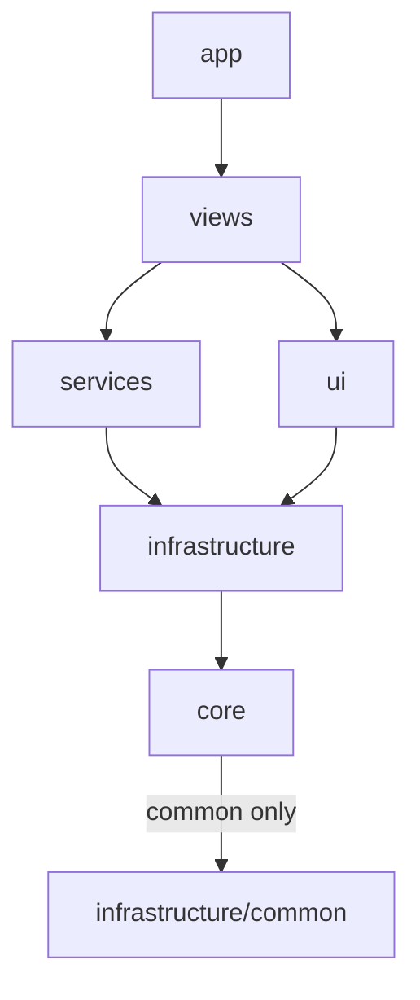

# AGENTS.md — MeetingBuddy

Native Windows app (C++ / WTL) that records microphone + system audio via WASAPI, mixes them
into one file in a user-chosen folder, and can optionally transcribe it locally (whisper.cpp)
to Markdown. Lives in the system tray. Two tabs: **Record** and **Recordings**.

Full design: `[.specs/app-design.md]`.  
Read the relevant section of the spec before implementing a feature. If you change the design, update the spec as well.

---

## Tech stack

| Area | Technology |
|---|---|
| Language | C++23 (MSVC, `/W4 /permissive- /utf-8 /Zc:preprocessor`), Unicode only (`UNICODE`, `_UNICODE`) |
| UI | WTL 10 on ATL/Win32, Common Controls v6, RichEdit 4.1 (`MSFTEDIT_CLASS`) |
| Audio | WASAPI shared mode, event-driven; mic = `eCapture`, system = loopback on `eRender` |
| Media | miniaudio 0.11 (WAV encode/decode, resample, mix); Media Foundation for M4A encode/decode |
| Transcription | whisper.cpp (ggml, CPU, static) — default model `ggml-base-q5_1.bin` |
| Build | CMake ≥ 3.24, `FetchContent` for WTL, Glaze, whisper.cpp, miniaudio, GoogleTest, WIL |
| Win32 / COM | WIL v1.0.260126.7 with `WIL_SUPPRESS_EXCEPTIONS` (header-only; throwing helpers off) |
| Generator | Visual Studio 18 2026 x64 (`CMakePresets.json` preset `default`), output in `build/` |
| Target OS | Windows 10 1903+ x64 |

Prerequisite: Visual Studio with the **Desktop C++** and **C++ ATL** components (WTL needs ATL).

---

## Build, run, restart

**Always use** `scripts/start.bat` **to build and (re)start the app:**

```powershell
scripts\start.bat
```

It locates CMake, **kills any running** `MeetingBuddy.exe`, configures `build/` on first run,
builds `Release`, and launches `build\Release\MeetingBuddy.exe`. Run it after every change you
want to verify. Don't launch the exe by hand, because a running instance locks the binary and
the single-instance mutex will hand over to the old process.

Other commands:

```powershell
scripts\format.bat                             # clang-format -i on src\ (or pass file paths)
cmake --preset default                         # configure (only if build/ is missing)
cmake --build build --config Release           # build only
ctest --test-dir build -C Release              # unit tests (scripts\test.bat)
```

**After every task that changes C/C++ under `src\`**, run `scripts\format.bat` (optionally with the
touched paths). `.clang-format` keeps `pch.hpp` first, then other project headers, then
`<windows.h>`, then `<atlbase.h>` and `<atlapp.h>` ahead of the other ATL headers, then the
remaining system headers. `SortIncludes` still sorts within each category.

If you add CMake options or FetchContent dependencies, delete `build/CMakeCache.txt` (or
reconfigure) so `start.bat` picks them up.

---

## Project layout

```
src/
  main.cpp, pch.hpp, Ids.hpp, Version.hpp
  app/             Application
  core/            AudioFormat, RingBuffer, ChunkPlan, MarkdownFormatter,
                   Recording, Transcript
  services/        RecordingSession, LevelMonitor, TranscriptionService
  infrastructure/
    audio/         DeviceManager, CaptureStream, SilentRenderKeepAlive, Mixer,
                   AudioResampler, MaConverter, MiniAudio.hpp, WavHeader, Resampler
    ai/            WhisperEngine, ModelManager
    storage/       Settings, RecordingLibrary, RecordingSidecar, DirectoryWatcher
    files/         WavWriter, M4aEncoder, AudioFileReader
    system/        Autostart, Hotkey, Clipboard
    common/        Log, HResult, Paths, Text, FileIo, Scoped.hpp, PostOwned.hpp
  ui/              TabCtrl, DeviceCombo, LevelMeter, RecordButton, TrayIcon,
                   ShellDialogs, Theme.hpp
  views/           MainWindow, RecordView, RecordingsView, TranscriptWindow,
                   SettingsDialog, ModelPrompt
resources/         MeetingBuddy.rc, resource.h, icons, MeetingBuddy.manifest
.specs/            design documents
```

## Finding files

Before searching `src\`, read the `folder.md` in the layer that matches the work. Start at [`src/folder.md`](src/folder.md) for process-wide files, or the `folder.md` in `app/`, `core/`, `services/`, `ui/`, `views/`, or `infrastructure/` and its subfolders. Each row says what the file is for, its technical role, its domain, and the feature names it participates in.

`tests/` folders have no `folder.md`. Do not index them.

When you add, remove, rename, or change what a production file is responsible for, update that folder's `folder.md` in the same change. A new subfolder gets its own `folder.md`. If the file moves between folders, update both indexes.

Each module keeps a `tests/` folder beside its sources (for example `src/core/tests/RingBufferTests.cpp`). Includes in those files stay rooted at `src`. Add each test `.cpp` only to the `MeetingBuddyTests` target in `CMakeLists.txt`, not to a `MEETINGBUDDY_*_SOURCES` list.

Every new production `.cpp` must be added to the matching `MEETINGBUDDY_*_SOURCES` list in `CMakeLists.txt`.
Keep DSP and file logic free of UI so it can be unit-tested.

## Source layers

Put a new file by answering the questions in order. If a class does work that belongs in two layers, split it rather than stretching one file across both.

Include paths stay rooted at `src` (for example `#include "infrastructure/common/Log.hpp"`).

### Include direction



- A file may include its own layer and any layer below it. It may not include a layer above it.
- `views` may include `ui`, `services`, `infrastructure`, and `core`.
- `ui` may include `infrastructure` and `core`. It may not include `views` or `services`.
- `services` may include `infrastructure` and `core`. It may not include `ui` or `views`.
- `infrastructure` may include `core` and `infrastructure/common`. It may not include `services`, `ui`, or `views`.
- `core` may include only other `core` files plus `infrastructure/common` (`Text`, `FileIo`, `Log`, and similar). It may not include `infrastructure/audio`, `ai`, `storage`, `files`, or `system`.
- `app` may include anything. In practice it only creates the message loop and `MainWindow`.
- `main.cpp`, `pch.hpp`, `Ids.hpp`, and `Version.hpp` stay at the `src` root because every layer uses them.

### What belongs in each folder

**`src/` root** — process-wide headers that every layer includes: `main.cpp`, `pch.hpp`, `Ids.hpp` (control IDs and `WM_APP_*` messages), `Version.hpp`. Do not add new types here.

**`app/`** — process lifetime only: COM and common-controls init, the WTL module, the message loop, the single-instance mutex. Today that is `Application`. Do not put windows, recording, or transcription here.

**`core/`** — domain types and in-process logic with no windows, devices, files, network, or third-party SDK headers.
- Put here: value types (`RecordingEntry`, `RecordingSidecar` fields, `TranscriptSegment`, `TranscriptStatus`), constants (`AudioFormat`, `kDefaultWhisperModel`), pure algorithms (`ChunkPlan`, `MarkdownFormatter`, `RingBuffer`).
- Do not put here: WASAPI capture, WinHTTP, Glaze I/O, whisper.cpp, miniaudio, Media Foundation, or any `HWND`.
- `AudioFormat.hpp` stays in `core`: it only describes the internal 48 kHz layout, even though that description uses the Windows wave-format headers.
- `Mixer` and `Resampler` stay out of `core` because they include miniaudio.

**`services/`** — application workflows that orchestrate infrastructure for one user-facing job. They own threads, queues, and session state machines. They talk to the UI only through `PostMessage(WM_APP_*)`.
- Put here: `RecordingSession` (one take: start, mix, write, stop), `LevelMonitor` (idle metering), `TranscriptionService` (FIFO queue, one job at a time).
- Do not put here: WASAPI open/close details, whisper.cpp calls, WAV encode, or window classes. Call those through infrastructure.
- Do not rename a class to a `Service` suffix to match the folder. A later workflow such as summaries would be a new file here.

**`infrastructure/`** — OS and library integrations. Each subfolder is one kind of adapter. If a helper is used from more than one subfolder, it goes in `common/`.

- **`infrastructure/audio/`** — capture devices and DSP that talks to WASAPI or miniaudio: `DeviceManager`, `CaptureStream`, `SilentRenderKeepAlive`, `Mixer`, `AudioResampler`, `MaConverter`, `MiniAudio.hpp`, `WavHeader`, `Resampler`.
- **`infrastructure/ai/`** — whisper.cpp and model files on disk: `WhisperEngine`, `ModelManager` (catalog, paths, SHA-256, download with no `HWND`).
- **`infrastructure/storage/`** — settings and recording metadata on disk: `Settings`, `RecordingLibrary`, `RecordingSidecar` (Glaze load/save), `DirectoryWatcher`.
- **`infrastructure/files/`** — audio file encode and decode: `WavWriter`, `M4aEncoder`, `AudioFileReader`.
- **`infrastructure/system/`** — Windows shell features that are not audio or files: `Autostart`, `Hotkey`, `Clipboard`.
- **`infrastructure/common/`** — small helpers any layer may use: `Log`, `HResult`, `Paths`, `Text`, `FileIo`, `Scoped.hpp`, `PostOwned.hpp`.

Do not put WTL windows or tab pages in `infrastructure`. Do not put domain structs here if they have no I/O; those belong in `core`.

**`ui/`** — reusable WTL/Win32 components with no knowledge of a specific screen.
- Put here: owner-drawn controls (`TabCtrl`, `DeviceCombo`, `LevelMeter`, `RecordButton`), tray icon wrapper, shared file dialogs (`ShellDialogs`), `Theme.hpp`.
- Do not put here: `MainWindow`, tab pages, settings or transcript windows, or any class that names a recording or a transcription job.

**`views/`** — windows, tab pages, and dialogs that compose `ui/` controls and call `services/`.
- Put here: `MainWindow`, `RecordView`, `RecordingsView`, `TranscriptWindow`, `SettingsDialog`, and dialog-only helpers such as `ModelPrompt`.
- A view may include `ui`, `services`, `infrastructure`, and `core`. It must not own WASAPI or whisper.cpp handles.

### Split when mixed

If one class both talks to an SDK and shows UI, split it:

- Keep the SDK or disk work in `infrastructure` with a callback or a result type, no `HWND`.
- Put the dialog, progress window, or file picker in `views`.
- `ModelManager` (infrastructure) downloads with no `HWND`. `ModelPrompt` (views) owns the progress window and file picker. `TranscriptionService::Enqueue` takes a `modelPath`; the view calls `ModelPrompt::EnsureModel` first.

Unit tests live in a `tests/` folder next to the type they cover and include the same layered paths as production code. DSP, file, and formatting tests should keep targeting `core` and `infrastructure` types that do not need audio hardware. Test translation units are not part of the production source lists.

Pending cleanup (milestone M0): delete the unused `src/Window.hpp`, pin WTL to a tag or commit
instead of `main`, use `project(... LANGUAGES C CXX)` (needed by ggml), and add the `.rc` file and
manifest (`IDR_MAINFRAME` currently has no resource behind it).

---

## Code conventions (match existing code)

- `#pragma once`; include `pch.hpp` first in every header or source that uses ATL/WTL.
- 4-space indent, braces on the same line, `PascalCase` types and methods, `m_` members,
`kConstant` for `static constexpr` constants, `camelCase` locals and parameters.
- Use `auto` for locals whose type is clear from the initializer (not for bool/int), and trailing return types
(`auto F() -> T`) when the return type is more than one word (`std::wstring`, `const T&`, `T*`); single-word types
like `HRESULT`, `LRESULT`, `bool` keep the prefix form.
- Qualify WTL types as `WTL::CButton` etc.; message maps use `BEGIN_MSG_MAP_EX` + `atlcrack.h`
crackers (`MSG_WM_*`, `COMMAND_ID_HANDLER_EX`).
- Put all control, menu, and resource IDs and `WM_APP + n` messages in `Ids.hpp` / `resource.h`.
Never use magic numbers.
- COM: `wil::com_ptr_nothrow`, and check every `HRESULT` (log + propagate). No naked `Release()`.
- No exceptions crossing COM, window-procedure, or thread boundaries.
- Write comments only for constraints the code can't express.
- Unit tests: mark distinct phases with `// Arrange`, `// Act`, and `// Assert` only when
  those phases are separable. Do not add other comments next to those markers. Skip AAA when
  arrange/act/assert are interleaved (e.g. a push/pop loop) or the body is a trivial one-liner.

---

## Architecture rules agents must follow

### Threads

- **UI thread**: windows only. Never block on audio, disk-heavy work, network, or the model.
- **Capture threads (mic, loopback)**: event-driven, register with MMCSS
(`AvSetMmThreadCharacteristicsW(L"Audio")`). They only copy packets plus QPC timestamps into an SPSC
lock-free `RingBuffer`. No allocations, locks, logging, or I/O in the hot path.
- **Mixer/writer thread**: mixes 10 ms blocks (480 frames @ 48 kHz) and writes WAV.
- **Transcription worker**: one job at a time from a FIFO queue, and it must be cancellable.
- Workers talk to the UI **only** via `PostMessage(WM_APP_*)`. Level meters are read from atomics on a
~30 Hz `WM_TIMER`. `IMMNotificationClient` callbacks just post a message.
- COM: STA on the UI thread, MTA on worker threads.

### Audio pipeline (spec §6)

- Internal format: **48 kHz, stereo, 32-bit float**. Request it with
`AUDCLNT_STREAMFLAGS_AUTOCONVERTPCM | AUDCLNT_STREAMFLAGS_SRC_DEFAULT_QUALITY`. If that fails,
use `GetMixFormat()` + a miniaudio data converter.
- Loopback delivers no packets during silence. Always run `SilentRenderKeepAlive` (feeds zeros to the
same render device), **and** fill gaps in the mixer from `u64QPCPosition`.
- Mixer: align by QPC; a gap over 5 ms becomes silence; emit a block when both sources cover it or it is
150 ms stale. Drift correction drops or duplicates single frames when fill levels diverge by more than 20 ms.
`out = clamp(micGain*mic + sysGain*sys)` (defaults 1.0 / 0.8; optional mic AGC), mic upmixed mono→stereo,
soft limiter above -1 dBFS.
- Handle `AUDCLNT_BUFFERFLAGS_SILENT`, `DATA_DISCONTINUITY`, and `AUDCLNT_E_DEVICE_INVALIDATED`
(reopen on the new default device, keep recording, fill the gap with silence).
- Session state machine: `Idle → Starting → Recording → Stopping → Idle` (+ `Error`).

### Files (spec §6.5)

- Name: `<folder>\MeetingBuddy_YYYY-MM-DD_HH-MM-SS.wav` (local time, `-2` suffix on collision).
- Output is PCM 16-bit, 48 kHz, stereo. Write to `*.wav.partial`, patch the RIFF header every 2 s, and rename on
stop. On startup, repair leftover `.partial` files to `*.recovered.wav`.
- Sidecars next to the audio: `<name>.md` (transcript), `<name>.json` (metadata + transcript status).
Delete, rename, and list operations treat audio + `.md` + `.json` as one unit. Delete goes to the Recycle Bin.
- App data: settings `%APPDATA%\MeetingBuddy\settings.json`; models
`%LOCALAPPDATA%\MeetingBuddy\models\`; logs `%LOCALAPPDATA%\MeetingBuddy\logs\`.
Default recordings folder: `%USERPROFILE%\Documents\MeetingBuddy`.

### Transcription (spec §7)

- **Optional**: never transcribe unless the user clicks *Transcribe* or enables auto-transcribe
(default off).
- Input: decode → mono → 16 kHz (miniaudio low-pass + linear resample) → `std::vector<float>`. Chunk recordings
longer than 1 h into 30 min pieces and offset the timestamps.
- whisper.cpp: `whisper_init_from_file_with_params`, `whisper_full_default_params(WHISPER_SAMPLING_GREEDY)`,
`language="auto"`, `n_threads = hw-1`, use `progress_callback` / `abort_callback`, and read segments with
`whisper_full_get_segment_t0/t1` (10 ms units).
- The **only** network access in the app is the user-initiated model download (WinHTTP, SHA-256 verified).
Never add telemetry or cloud calls.
- Markdown output: `# Meeting — <date time>`, a metadata bullet list, `## Transcript`, then paragraphs
prefixed with `**[hh:mm:ss]**`. Start a new paragraph after a pause over 1.5 s or every ~60 s. Remove repeated
hallucinated lines. Save as UTF-8 without BOM.

### UI (spec §8)

- Main window: resizable frame with `CTabCtrl`. Each tab page is a child `CDialogImpl` with `CDialogResize`, and there is a
status bar. Per-monitor DPI aware.
- **Record tab**: INPUT/OUTPUT sections, mic and system device combos, a read-only "Save to" path with Browse…
(`IFileOpenDialog` + `FOS_PICKFOLDERS`), an owner-drawn Record/Stop pill button, a large elapsed timer with blinking
REC indicator, and dB-scaled level meters (segmented fill + peak hold). Inputs are disabled while recording.
- **Recordings tab**: report-view `CListViewCtrl` with columns Name | Date | Duration | Size | Transcript, newest first. Actions:
Play, Transcribe, View transcript, Open folder, Rename, Delete, Refresh. Kept in sync via `ReadDirectoryChangesW`.
- **Transcript window**: read-only RichEdit showing the Markdown **source** with light styling. Toolbar has Copy all
(`CF_UNICODETEXT`), Save as, Open in editor, and Find. Copied text must stay plain Markdown.
- **Tray**: `Shell_NotifyIconW` v4. Icons for idle and recording. Left click toggles the window. Menu: Show, Start/Stop
recording, Open folder, Settings, Exit. Minimize and close hide to the tray (configurable). Re-add the icon on
`TaskbarCreated`. Show balloons for transcript ready, low disk, and device lost.
- Single instance: mutex `Local\MeetingBuddy.SingleInstance`. A second launch activates the existing window.
- When the user exits during a recording, ask whether to stop and save. `WM_ENDSESSION` always stops and saves.

---

## Milestones (implement in order; each must build and run via `scripts\start.bat`)

1. Foundation: cleanup, C++20, pinned deps, `.rc`/manifest/icons, logging, Settings, single instance.
2. Shell UI: tabs, status bar, tray, hide to tray.
3. Mic capture → WAV, Record/Stop, timer, folder picker.
4. Loopback + keep-alive + ring buffers + mixer + meters (+ unit tests).
5. Robustness: device changes, low disk, crash recovery, privacy denied, exit while recording.
6. Recordings tab + `RecordingLibrary` + sidecar JSON.
7. whisper.cpp integration, resampler, model manager, transcription queue, Markdown formatter.
8. Transcript window, transcript status column, completion balloon.
9. Settings dialog, hotkey (`Ctrl+Alt+R`), start with Windows, DPI, optional M4A.
10. Release packaging and manual test pass (spec §11).

---

## Verification checklist for agents

- If a production file under `src\` was added, removed, renamed, or its responsibility changed, update that folder's `folder.md`.
- Run `scripts\format.bat` after the task (whole `src\` or only the files you changed).
- The build is warning-clean at `/W4`, and `scripts\start.bat` builds and launches successfully.
- Unit tests pass for any touched DSP, file, or formatting code (`RingBuffer`, `Mixer`, `WavWriter`, `Resampler`,
`MarkdownFormatter`, `RecordingLibrary`).
- For audio changes, record about 1 min while toggling playback and talking. Check that both sources are audible and
in sync and that the file plays in the default player.
- The UI stays responsive during recording and transcription (no work on the UI thread).
- No new network calls, and no files written outside the recordings folder and the app data paths above.
