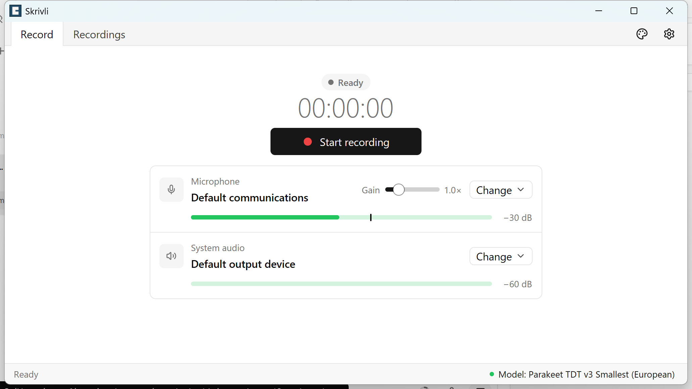
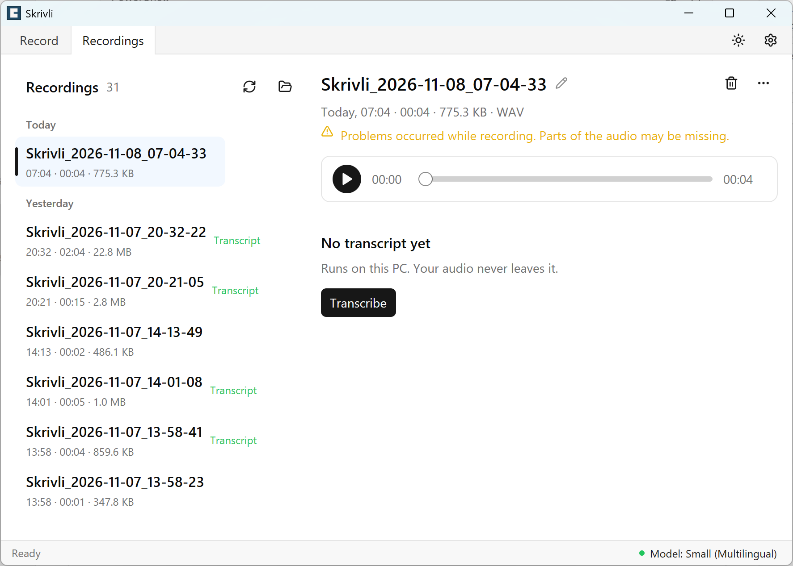

# Skrivli

Skrivli is a Windows app that records and transcribes meetings entirely on your computer, keeping your audio and text private.

## Features

- **Records both sides of a call.** Your microphone and system audio go into one continuous WAV file. Silence is kept, so the timing stays correct.
- **Echo removal.** When system audio is captured, speaker echo is removed from the microphone automatically.
- **Live level meters** for each source, with peak hold and a manual microphone gain slider.
- **Device selection.** Pick any Windows microphone or output device. Devices are locked while recording.
- **Start and stop anywhere:** from the window, the system tray, or a global hotkey (default `Ctrl+Alt+R`).
- **Tray mode.** Hide the window to the tray and the recording keeps running.
- **Reliable saving.** If something fails during a recording, the audio captured so far is saved. You get a warning when disk space runs low, and a recording is still saved if one device drops.
- **Recordings library** grouped by Today, Yesterday and Earlier. It updates live when files change, and has playback with a seek bar, rename, delete to the Recycle Bin, and Show in folder.
- **Offline transcription** with whisper.cpp. Choose multilingual, English or Swedish (KB-Whisper) models, downloaded only when you ask. Transcripts have `[HH:MM:SS]` timestamps, are saved as `.txt` files next to the audio, can be copied with one click, and highlight the current paragraph during playback.
- **Light, dark and system themes**, keyboard navigation, single instance, and the window remembers its size and position.

## Screenshots

### Record



### Recordings



## For developers

### Local build

Target: `x86_64-pc-windows-msvc` on Windows 10 or 11.

1. Install [rustup](https://rustup.rs/) and the stable toolchain (`rust-toolchain.toml` selects `stable`). If `cargo` is not on `PATH`, prepend the rustup bin directory:
   ```powershell
    $env:Path = "$env:USERPROFILE\.cargo\bin;" + $env:Path
   ```
2. Install the MSVC Build Tools (Visual Studio Build Tools workload "Desktop development with C++") and a Windows 10/11 SDK. The linker is `link.exe` from that toolchain.
3. DPI awareness is Per-Monitor V2. `gpui-pre` 0.3.11 already embeds that manifest, and the MSVC linker rejects a second one, so `build.rs` embeds the icon and version resource only. `resources/skrivli.manifest` is the same DPI contract, kept in the repo and not embedded. 100% and 150% scaling were not exercised on hardware for this milestone.

### Commands

```powershell
cargo fmt --all -- --check
cargo clippy --all-targets -- -D warnings
cargo test
cargo build --release
cargo run
```

`cargo test` does not use a microphone, a GPU device check, or an interactive window. `cargo run` opens the Skrivli window.

## License

Skrivli is an open-source meeting recording and transcription application.

Copyright © 2026 Alexis Harabchuk.

Skrivli is licensed under the **GNU General Public License, version 3.0 only (GPL-3.0-only)**.

You may use, modify, and redistribute this software under the terms of the GNU GPLv3.

This software is provided without warranty, as described in the license.

See [LICENSE](LICENSE) for the complete license terms.