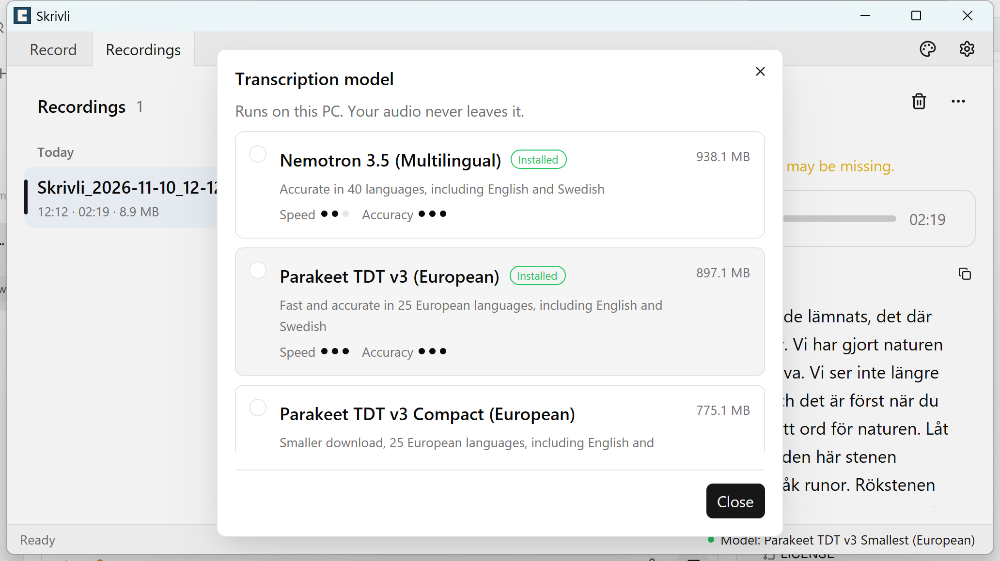

# Skrivli

Skrivli is a Windows app that records and transcribes meetings entirely on your computer, keeping your audio and text private.

## Download and installation

Skrivli is distributed as a portable Windows application in a ZIP archive.

**Install**
1. Download from the [Releases](https://github.com/harabchuk/skrivli/releases) page.
1. Unzip the whole folder anywhere you like.
1. Run skrivli.exe. There is no installer.

## Features

- **Records both sides of a call.** Your microphone and system audio go into one continuous FLAC file (lossless, 16-bit stereo 48 kHz). Silence is kept, so the timing stays correct.
- **Echo removal.** When system audio is captured, speaker echo is removed from the microphone automatically.
- **Live level meters** for each source, with peak hold and a manual microphone gain slider.
- **Device selection.** Pick any Windows microphone or output device. Devices are locked while recording.
- **Start and stop anywhere:** from the window, the system tray, or a global hotkey (default `Ctrl+Alt+R`).
- **Tray mode.** Hide the window to the tray and the recording keeps running.
- **Reliable saving.** If something fails during a recording, the audio captured so far is saved. You get a warning when disk space runs low, and a recording is still saved if one device drops.
- **Recordings library** grouped by Today, Yesterday and Earlier. It updates live when files change, and has playback with a seek bar, rename, delete to the Recycle Bin, and Show in folder.
- **Offline transcription** with parakeet.cpp and your choice of three NVIDIA model families: Nemotron 3.5 (40 languages), Parakeet TDT v3 (25 European languages) and Parakeet TDT v2 (English only). The multilingual families include English and Swedish, and detect the language automatically. Smaller Compact and Smallest variants are available. A model is a one-time download of about 675 MB to 984 MB, only when you ask. Transcripts have `[HH:MM:SS]` timestamps, are saved as `.txt` files next to the audio, can be copied with one click, and highlight the current paragraph during playback.
- **Light, dark and system themes**, keyboard navigation, single instance, and the window remembers its size and position.

## Screenshots

### Record

### Recordings

### Model selection

## For developers

### Contribution

PRs are welcome. Each PR should fix only one issue and contain human readable explanation of the issue and the way it has been fixed.

For new features PRs please explain the problem and the goal from user perspective.

### Building and releasing

- [Building locally](docs/building.md)
- [Releasing](docs/releasing.md)

## License

Skrivli is an open-source meeting recording and transcription application.

Copyright © 2026 Alexis Harabchuk.

Skrivli is licensed under the **GNU General Public License, version 3.0 only (GPL-3.0-only)**.

You may use, modify, and redistribute this software under the terms of the GNU GPLv3.

This software is provided without warranty, as described in the license.

See [LICENSE](LICENSE) for the complete license terms.